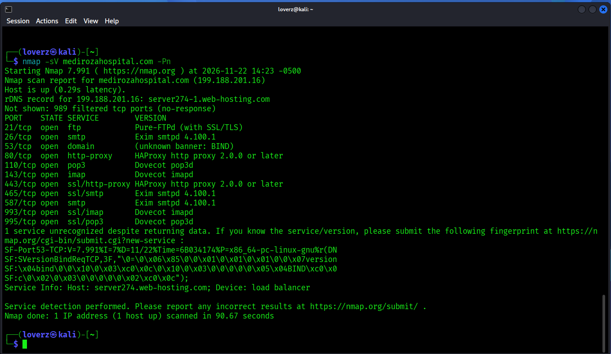
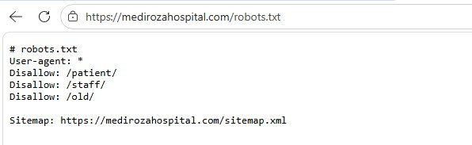
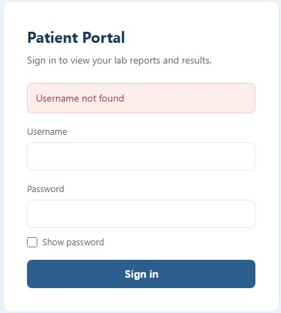
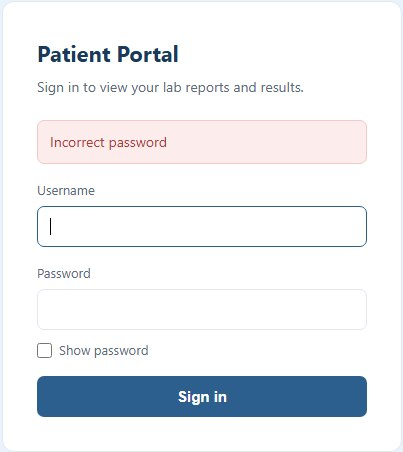
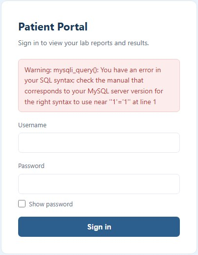

# MEDIROZA-GENERAL-HOSPITAL
## PENETRATION TEST REPORT
________________________________________
### WEB APPLICATION SECURITY ASSESSMENT
________________________________________

### ASSESSMENT DETAILS

Target Website: https://medirozahospital.com

Application: Mediroza Hospital Patient Portal

Organization: Networkwalks

Assessment Type: Black-Box Web Application Penetration Testing

Assessment Date: 23 November 2026

Report Classification: CONFIDENTIAL

________________________________________

PREPARED FOR: Mediroza General Hospital

PREPARED BY: Lovemore Chamboko
________________________________________

### CONFIDENTIAL SECURITY DOCUMENT

This report contains sensitive security assessment findings and is intended solely for authorized review by the relevant stakeholders of Mediroza General Hospital and Networkwalks.

### 1. Executive Summary

A black-box security assessment was conducted against the Mediroza General Hospital web application, focusing on the publicly accessible web interface, authentication controls, patient portal functionality, and exposure of sensitive back-end information.

The assessment was conducted in four phases

1.	Initial Access (M1): Conducting an initial investigation on Target’s website to check authentication mechanism and to identify security weakness that could lead to unauthorized access to the target website.
3.	Data Extraction (M2): Examining the recovered Patient report pdf files to investigate and analyses the password protection mechanism.
4.	Data Exposure (M3): Investigating the critical data exposure on the client server, an exposed database backup containing critical information about the company and employees.
5.	Penetration Testing Report (M4): Writing a report documenting all the findings during the penetration testing, potential impact, risk ratings and recommendations of security improvements that can be implemented.

During the penetration testing several vulnerabilities were identified ranging from medium to critical. Vulnerabilities such as SQL injection on the patient portal login page allows bypass authentication without knowing the login credentials. After logging in, critical patient information was accessed, downloaded and cracked to review sensitive metadata. There was also an exposed database backup that presents a serious confidentiality risk because it makes sensitive organizational and personally identifiable information accessible to external parties.
The findings indicate weaknesses in authentication security and the protection of sensitive server-side files.

### Overall Risk Rating: CRITICAL

The combination of potential unauthorized portal access and publicly exposed confidential database information represents a substantial security risk to the organization.

### 2. Scope

A full black-box penetration test to identify vulnerabilities, exploit them and document all the findings. The assessment focused on the following publicly accessible resources:

Component	Target
Hospital website	medirozahospital.com
Patient portal	/patient/portal.php
Database backup	/old/mediroza_db_backup_2019.sql
Authentication	Patient portal access controls
Data confidentialit	Publicly accessible database files
Laboratory reports	Report listing and download functionality

### 3. Methodology

The assessment followed a full black-box testing approach, examining the application from an external perspective without relying on internal system documentation.

The assessment methodology included:

1.	Reconnaissance: Examination of publicly accessible application pages and URLs to find information about the target.
2.	Scanning and Enumeration: Examining the target website through scanning for open ports, services running, exposed critical information.
3.	Exploitation: Analyze and exploit each identified vulnerability using deferent tools through controlled environment.
4.	Documentation: Documenting all the findings, evidence and remediation recommendations in this report

### 3.1 Tools 

Tools	Purpose
Kali Linux	A Linux-based operating system containing tools for penetration testing, ethical hacking, and security auditing.
Nmap	Used for network scanning, host discovery, port scanning, and identifying running services.
Browser (Chrome & Firefox)	Used to access and test websites, inspect web pages, and identify web application security issues.
Curl	A command-line tool used to send HTTP/HTTPS requests and examine server responses.
WhatWeb	Used to identify website technologies, CMS platforms, frameworks, and server information.
NSlookup	Used to find DNS records and obtain domain-to-IP address information.
Networkwalks Hash Calculator	Used to generate hash values from text or data using different hashing algorithms.
Networkwalks Hash Cracker	Used to test and recover passwords from hashes using password-cracking techniques.
WHOIS	Used to retrieve domain registration information, registrar details, registration dates, and name servers.
Wafw00f	Used to detect and identify Web Application Firewalls (WAFs) protecting websites.
ChatGPT	Used to understand cybersecurity concepts, explain tool outputs, troubleshoot commands, and assist with penetration-testing documentation.
Jonh the Ripper	A password-auditing tool used to test password strength and recover passwords from supported password hashes.

### 3.2 Scanning the target for open ports and services using nmap

### Critical Information Disclosed

### 4.  Accessing Patient Portal Login Page

### 4.1 Username Enumeration

### Risk Rating: Medium

The process of identifying valid user accounts and assessing password-related security weaknesses in a system, website, or network. This process helps penetration testers evaluate authentication security and identify risks that could lead to unauthorized access. 
Patient portal login page was accessed and tested using different combinations of usernames and passwords, showing different error messages confirming that one of the usernames was valid but with a wrong password.

#### Username Not Found

#### Incorrect Passwprd

A username field was tested for SQL injection using 

Username: admin’ and Password: Password

### 4.2 Patient Portal Authentication Bypass

### SQL Injection Login Bypass

### Rask Rating: Critical

Is a web application security vulnerability in which an attacker manipulates database queries through improperly validated login inputs to potentially bypass authentication. Penetration testers examine login forms to determine whether user input is safely handled by the application's database. If the application directly combines user input with SQL commands instead of using secure parameterized queries, malicious input may alter the intended query logic. 
In this penetration test I was able to comment out the password and login without using a password.
 

### The portal displays the following report metadata:

•	Pathology Report – S. Dlamini

•	Pathology Report – P. Reddy

•	Pathology Report – E. Thompson

### 4.3 Access Gained

### Risk Rating: High

After gaining unauthorized access to the patient portal using SQL injection, critical findings were identified (three patient lab reports in a pdf format was available to download). This confidential medical lab reports should only be accessible to the patient and their doctors only.  
After gaining access I was able to download three listed lab reports for different patients. Each entry includes a laboratory reference, report date, and encrypted PDF file.
 
### 4.4 Finding and Cracking Weak Password

In this penetration testing an online Password cracker and Hash calculator from Networkwalks was used to identify the hashes of the documents and to crack the passwords. 

### Hash1

 
### Hash2

 
### Hash3

 
### Password1
 

### Password2
 

### Password3

The password for patient report 3 pdf file was cracked using John the Ripper. 
 

### 5.	Evidence of Unlocked PDF files

### PDF1

 
### PDF2

### PDF3

 
### 5.1 Security Impact

•	Access patient laboratory report listings.

•	Obtain sensitive patient-related information.

•	Attempt unauthorized access to protected report downloads.

•	Compromise patient confidentiality.

•	Use the portal as an entry point for further application attacks.

The exposure of medical information is a result of privacy violations, regulatory consequences, and reputational damage.

### 5.2 Recommendations

1.	Implement parameterized SQL queries and prepared statements throughout the authentication system.
2.	Enforce role-based access control on all patient portal resources.
3.	Introduce login rate limiting and suspicious authentication attempt monitoring.
4.	Review authentication logs for suspicious SQL injection attempts.
5.	Verify that report download endpoints enforce authorization independently of the portal interface
6.	Public Exposure of Internal Database Backup 

Nikto was used during penetration testing a several web directories were discovered and it led to critical information disclosure. Information about company shareholders and employee details and salaries. 
 

### 6.1 Sensitive Information Disclosure

### Risk Rating: CRITICAL

Affected URL: https://medirozahospital.com/old/mediroza_db_backup_2019.sql

An internal SQL database backup belonging to Mediroza General Hospital was accessible through a publicly reachable web URL.

The file is named: mediroza_db_backup_2019.sql

The contents identify it as an internal database backup generated by Mediroza CMS version 1.4.2. The backup contains database structures and records associated with the hospital's internal staff information. The database backup was accessible directly through a web browser without any visible authentication requirement. This represents a critical information disclosure vulnerability. The backup includes populated SQL INSERT statements containing actual staff records. The exposed information includes employee identities, professional positions, departments, contact details, national identification numbers, salary information, and employment dates.

### Evidence
 
 
 
### 6.2 Security Impact

This vulnerability presents a critical confidentiality risk. Critical information was obtained:

•	Personally identifiable information (PII).

•	Employee contact information.

•	National identification numbers.

•	Internal organizational structures.

•	Employee salary information.

•	Employment history.

•	Information potentially useful for targeted phishing and social engineering.

The exposure of national identification numbers and personal contact information increases the risk of identity theft and targeted fraud. The disclosure of salary information and internal organizational information may also create operational, financial, and reputational risks. Additionally, the backup's contents help the attacker to understand the organization's database architecture and identify further attack opportunities.

### 6.3 Recommendations

1.	Remove the exposed SQL backup from the publicly accessible web directory.
2.	Store database backups outside the web root and public document directories.
3.	Restrict backup access to authorized administrators.
4.	Review web server configuration to prevent public access to database dumps and backup extensions.
5.	Identify and remove other publicly accessible backup files, including .sql, .bak, .old, .zip, and .tar.gz files.
6.	Review web server access logs to determine whether the exposed backup was accessed or downloaded by unauthorized parties.

### 6.4 Additional security improvements:

1.	Encrypt database backups using strong encryption.
2.	Apply strict access controls to backup storage locations.
3.	Establish a secure backup retention and deletion policy.
4.	Conduct periodic external exposure assessments.
5.	Implement automated monitoring for accidentally published sensitive files.
6.	Assess applicable privacy and data protection notification obligations.

### 8. Overall Security Posture

The observed weaknesses suggest deficiencies in:

•	Authentication security.

•	Sensitive file access restrictions.

•	Database backup management.

•	Confidential information protection.

•	Web server security configuration.

The organization should prioritize the removal of exposed database backups and independently validate the authentication weakness.

### Remediation Roadmap

Priority	Recommended Action	Timeline
P1	Remove public database backup	Immediate
P1	Restrict access to backup directories	Immediate
P1	Investigate potential unauthorized access to exposed data	Immediate
P1	Validate and remediate authentication bypass	24–48 hours
P2	Review portal authentication and authorization	7 days
P2	Review server access logs	7 days
P2	Implement prepared SQL statements	7–14 days
P3	Introduce secure backup management procedures	30 days
P3	Conduct a follow-up penetration test	After remediation

### 9. Conclusion

The black-box assessment of the Mediroza General Hospital web application identified significant security weaknesses involving potential authentication bypass and exposure of sensitive internal database information. The publicly accessible SQL database backup represents a critical security issue because it contains confidential employee records, including personally identifiable information, contact information, national identification numbers, and salary details.
These findings demonstrate the importance of implementing secure authentication mechanisms, restricting access to sensitive server-side resources, and establishing appropriate database backup protection procedures. Immediate remediation is recommended, followed by a comprehensive security reassessment to confirm that the identified vulnerabilities have been resolved.

Final Assessment: CRITICAL overall risk, driven by the confirmed public exposure of sensitive database records.

________________________________________

## END OF REPORT

### Classification: Confidential – Security Assessment

### Prepared for: Mediroza General Hospital and Networkwalks

### Prepared by: Lovemore Chamboko

### Assessment Type: Black-Box Web Application Penetration Testing
